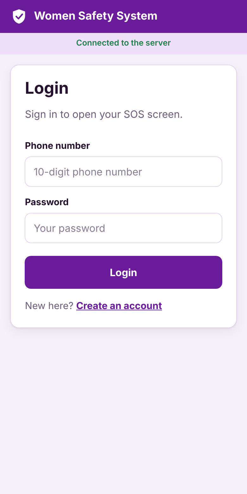
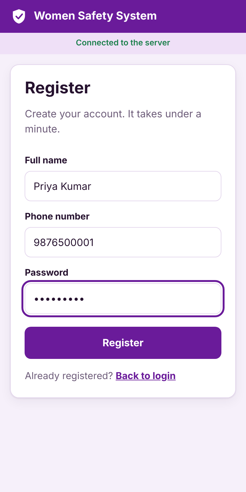
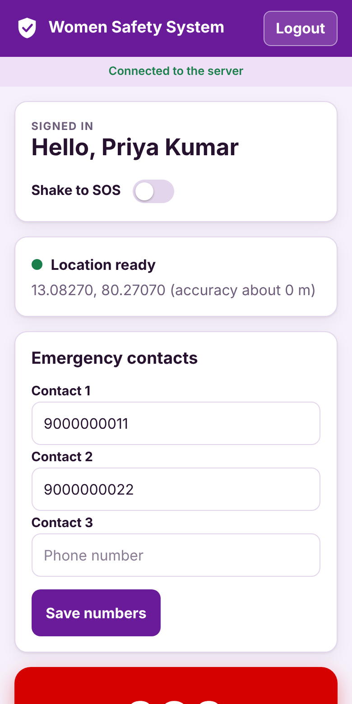
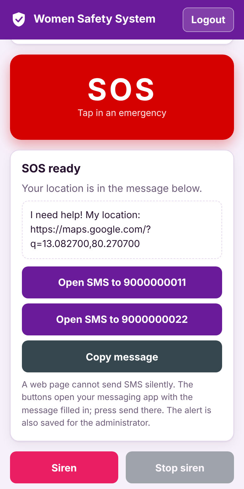
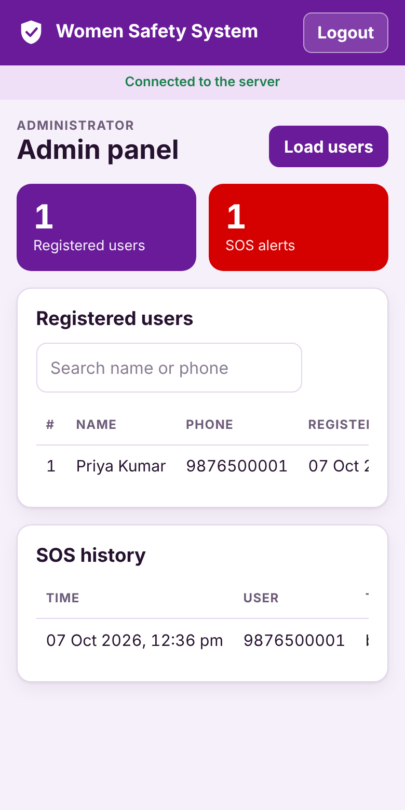
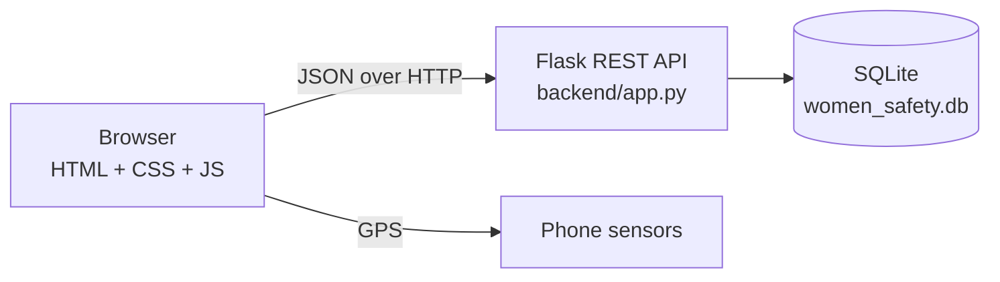

# Women Safety System

A web application that helps a woman call for help in an emergency. She saves up to three trusted phone numbers; in danger she taps **SOS** and the app prepares a message with her live Google Maps location for those contacts. It also has a loud siren, a fake incoming call, shake-to-SOS, and an admin panel.

Built as a BCA final-year project: **HTML + CSS + JavaScript** front end, **Python Flask** back end, **SQLite** database.

<p>
  
  
  
  
  
</p>

## Features

| Feature | What it does |
|---|---|
| Register / Login | Phone number + password. Passwords are stored as salted hashes. |
| Emergency contacts | Save up to three 10-digit numbers per user. |
| SOS | Reads GPS, builds `I need help! My location: https://maps.google.com/?q=lat,lng`, saves the alert, and opens the messaging app for each contact. |
| Shake to SOS | Optional. Shake the phone to trigger SOS. |
| Siren | Loud alternating tone with a stop button. |
| Fake call | Incoming call screen after 5 seconds, to leave an unsafe situation. |
| Call contact | One tap to call the first saved contact. |
| Admin panel | Lists registered users and every SOS alert with a map link. |

## Tech stack

| Layer | Technology |
|---|---|
| Front end | HTML5, CSS3 (responsive, dark mode), vanilla JavaScript, Geolocation, Web Audio, DeviceMotion |
| Back end | Python 3, Flask, REST API (JSON) |
| Database | SQLite (tables: `users`, `contacts`, `sos_alerts`, `sessions`) |
| Tests | `unittest` with the Flask test client (16 tests), GitHub Actions |

## How it fits together



The Flask server also serves the files in `frontend/`, so one command runs the whole app.

## Quick start

### On your computer

```bash
git clone https://github.com/<your-username>/women-safety-system.git
cd women-safety-system
pip install -r requirements.txt
python backend/app.py
```

Open <http://localhost:5000>. The top bar shows **Connected to the server**.

### In GitHub Codespaces (no installation)

1. On the repository page choose **Code → Codespaces → Create codespace on main**.
2. In the terminal run `python backend/app.py`.
3. Open the **Ports** tab, right-click port **5000**, set **Port Visibility → Public**, and open the link. It is `https`, so GPS works on a phone too.

### Logins

| Role | Username | Password |
|---|---|---|
| Admin | `admin` | `admin123` |
| User | register on the Register screen | at least 6 characters |

Change the admin login with the environment variables `WS_ADMIN_USER` and `WS_ADMIN_PASS`.

## REST API

| Method | Path | Access | Body / result |
|---|---|---|---|
| GET | `/api/health` | public | `{ok: true}` |
| POST | `/api/register` | public | `{name, phone, password}` |
| POST | `/api/login` | public | `{phone, password}` returns `{token, user}` |
| GET | `/api/contacts` | logged in | `{contacts: [3 numbers]}` |
| PUT | `/api/contacts` | logged in | `{contacts: [..]}` |
| POST | `/api/sos` | logged in | `{lat, lng, trigger}` |
| GET | `/api/users` | admin | `{users: [...]}` |
| GET | `/api/sos` | admin | `{alerts: [...]}` |

Login returns a random token valid for 7 days. Send it as `Authorization: Bearer <token>`.

## Run the tests

```bash
cd backend
python -m unittest discover -s tests -v
```

The tests cover registration rules, duplicate numbers, wrong passwords, password hashing, contacts, SOS logging, admin-only access and token checks.

## Project structure

```
women-safety-system/
├── backend/
│   ├── app.py              Flask server and REST API
│   └── tests/test_api.py   API tests
├── frontend/
│   ├── index.html          Login, Register, SOS home, Admin screens
│   ├── css/style.css       Styling, dark mode, responsive layout
│   └── js/
│       ├── api.js          Talks to the REST API (demo mode if no server)
│       └── app.js          Screens, GPS, SOS, siren, fake call, shake
├── docs/screenshots/
├── .github/workflows/      Tests and GitHub Pages
├── .devcontainer/          Codespaces setup
└── requirements.txt
```

## GitHub Pages demo (optional)

The workflow in `.github/workflows/pages.yml` publishes `frontend/` as a static site. GitHub Pages cannot run Python, so the site starts in **demo mode** and keeps data in the visitor's browser. To enable it: **Settings → Pages → Source: GitHub Actions**.

## Limitations

- A web page cannot send SMS silently. SOS opens the messaging app with the message filled in and the user presses send. The alert is also stored on the server for the administrator.
- GPS in browsers needs `https` or `localhost`.
- No password reset and no login-attempt limit yet.
- Change the default admin password before real use.

## Future scope

Automatic SMS through a gateway such as Twilio, push notifications, per-contact live tracking, password reset by OTP, a safe-timer check-in, and a native mobile app.

## License

MIT, see [LICENSE](LICENSE).
